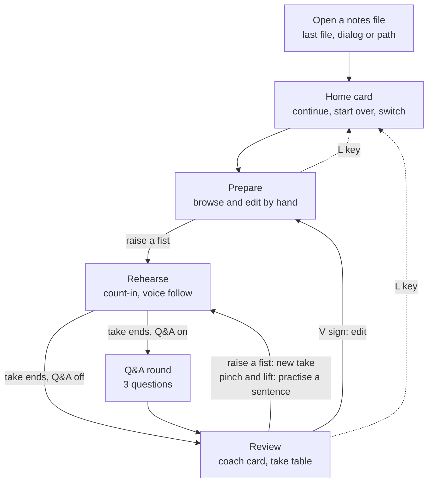
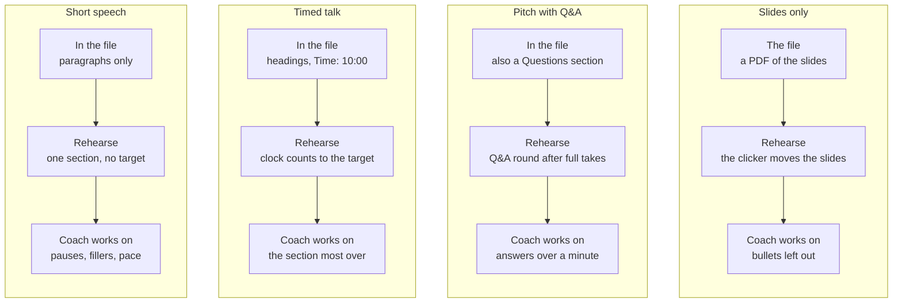

# PalmCards

A gesture-controlled rehearsal mirror for words you have to say out loud. Open a `.txt`, `.md` or `.docx` file, or the PDF of your slides, and its text floats beside your mirrored webcam image. After that, your hands control the app.

1. **Prepare.** Read and edit your notes with hand gestures. Select a word, a sentence or a paragraph. Try other words, change a sentence's tone, or make a paragraph shorter or fuller.
2. **Rehearse.** Speak a take. The notes follow your voice. The take stops by itself after your last sentence.
3. **Review.** PalmCards measures each take: pace, fillers, pauses, restarts, pitch and loudness range, where you looked, your hands and your posture. It sets your takes side by side and gives one coaching point per take: what went well, what to work on, and what to practise next.

PalmCards runs on a Mac with Apple silicon. Windows is not supported.

The app, the recording and the analysis run on your Mac. After you download the models, PalmCards works offline. An optional language model gives word meanings, other words, rewrites and AI coaching. It can run on your Mac (Ollama) or in the cloud (Anthropic). It is off by default.

## How it flows



PalmCards has no setting for the kind of text. What you write in the file turns features on, and they add up: a pitch gets everything a timed talk gets, plus the Q&A round.



The written kinds get the same voice follow, takes side by side, sentence practice and fading cards. The Q&A round runs only when you turn it on with `y`. Written notes can also show their slides: add the PDF on the home card.

## Install

You need Python 3.12 and [uv](https://docs.astral.sh/uv/). The lock file needs 3.12, and MediaPipe has no wheels for newer versions yet.

```sh
uv venv --python 3.12 .venv
uv pip install --python .venv/bin/python -r requirements.lock.txt   # the exact tested versions
.venv/bin/python scripts/download_models.py                           # ~1.7 GB, checksummed, pinned revisions
```

`requirements.txt` lists the direct dependencies. If you install from it instead of the lock file, add `"numpy<2"` to every install command. MediaPipe 0.10.21 needs NumPy 1.

### Permissions

macOS asks for these on first use. Allow them for the terminal app you start PalmCards from (System Settings > Privacy & Security):

- **Camera**, for the mirror and hand tracking.
- **Microphone**, for takes. Without it, macOS records silence and does not fail. PalmCards then shows `Take 2 is silent. Check microphone access.` until the next take starts.
- **Speech Recognition**, only if you set the speech engine to Apple's recogniser (`SPEECH.backend = "apple"` in `palmcards/config.py`).

## Start

```sh
.venv/bin/python main.py                       # the file you opened last, else an Open dialog
.venv/bin/python main.py my-talk.md            # a .txt, .md or .docx file
.venv/bin/python main.py my-deck.pdf           # slides only: practise freely from them
.venv/bin/python main.py --new my-talk.md      # a new session, not the last one continued
.venv/bin/python main.py --open RUN            # a saved session, in Review
```

Other options: `--video` records video of each take, `--fade` turns on fading cards, `--llm ollama|anthropic` turns on the language model, `--no-follow` stops the notes following your voice, and `--lang xx` sets the language you speak (default `en`).

If you open a file that has not changed since you last rehearsed it, PalmCards continues that session, with your edits and takes. A changed file starts a new session.

The window opens at once and says what is loading. If PalmCards cannot continue (no camera picture, models not downloaded, a file it cannot read), the window says what to do. Everything the app prints is also kept in `logs/` beside the sessions, one file a day.

### Switch speech without quitting

The **home card** lets you change speech inside the app. It shows at start when PalmCards reopened your last file by itself, and when you press `l` in Prepare or Review. It lists:

- **Continue** the speech that is open now;
- **Start it over**, as a new session (your old takes stay saved);
- up to four **other speeches** you practised before, newest first;
- **Add slides…**, a PDF to show beside your written notes in a take;
- **Open another file…**, in the macOS Open dialog: notes, or slides as a PDF.

To choose a row, raise one or two fingers and move your hand up or down, then tap. You can also use the keys: `j` and `k` move, `Enter` or `1` to `9` choose, and `l` or `Esc` close the card.

## Write your notes

Notes are plain text. A blank line starts a paragraph. A section starts at a `#` heading (`.txt`, `.md`), a Heading or Title style (`.docx`), or two blank lines (`.txt`). Two things in the file are not part of the talk:

- A line `Time: 3:00` (or `Target:` or `Length:`) sets the target length of the talk.
- A section headed `Questions` (or `Q&A`, `Likely questions`) holds practice questions for the Q&A round, one per sentence.

Old delivery marks such as `/`, `*word*` or `[slow]` are not supported. PalmCards removes them from the text and says how many it ignored.

### Slides

Export your slides as a PDF from Keynote, PowerPoint or Google Slides. You can use them in two ways:

- **Slides only.** Open the PDF as the speech. Each slide with text becomes a section, and each line on it (the title and each bullet) becomes a point to make. Review then shows which bullets you covered. A deck that is only images cannot be used this way: write notes for it, then add the slides.
- **Notes plus slides.** Open your written notes, then choose **Add slides…** on the home card (`l`). PalmCards keeps the PDF's location and reads it again each time, so a deck you export again shows its new slides.

## Prepare

Hold a hand in the box on the right of the frame. The highlight follows your hand in the notes on the left. On the first run, a tutorial card teaches one gesture at a time (`g` shows or hides it).

| Hand shape | Browses |
| --- | --- |
| One finger up | words |
| Two fingers together | sentences |
| Flat hand | paragraphs |

To select, tap: curl your fingers down and straighten them again quickly, like a click in the air. To go back, lower your hand for one second. To scroll, move your hand to the top or bottom of the box.

What you can do with a selection:

- **A word.** PalmCards shows the word's meaning in context. Hold an open palm to open a ring of other words. Make an L (thumb and index finger out) and turn it like a knob to choose one. The word in the sentence changes as a preview.
- **A sentence.** Make an L and tilt it to change the tone: toward formal on one side, toward warm and conversational on the other.
- **A paragraph.** Make an L with each hand. Move your hands closer for about 70% of the words, or apart for about 130%.

To use a change, pinch and lift: pinch your thumb and index finger, then raise your hand quickly. PalmCards saves a new revision of the notes and never changes your imported file. To undo the last edit, hold a V sign (index and middle fingers out and apart) for one second, or press `u`.

Meanings, other words, tone and length need the optional language model. Without it, the controls show and say that they need it. Nothing is ever changed without your pinch and lift.

## Rehearse

To start a take, raise a closed fist and hold it for one second. A 3-2-1 count-in follows. The count-in is one second once the session has a take.

- **Eye calibration.** In the first count-in of a session, look into the camera lens, then read the orange sentence. PalmCards uses this to tell when you look at the screen and when you look away.
- **Voice follow.** The current sentence is orange, and the notes scroll as you speak. You can move by key: `n` and `b` for the next and previous section, `j` and `k` for the next and previous sentence.
- **Stop.** The take stops by itself after a short silence at the end of your last sentence. To stop earlier, hold an OK sign (thumb and index fingertips in a circle, the other fingers up) for 1.5 seconds, anywhere in the frame. In a take, this is the only gesture command.
- **Target length.** With a target, the clock shows `REC 1:12 / 3:00` and turns orange when you go over. The label shows the time left for the current section. Press `]` or `[` to make the target 15 seconds longer or shorter.
- **Fading cards** (key `w`, off by default). Words you said correctly in the last takes dim, then blank out, so you learn to speak from memory. If you pause, the next words come back.
- **Q&A round** (key `y`, off by default). After a full take, three practice questions follow. Each one shows in large type, and you answer it aloud as a take of its own. The questions come from your notes, or from the language model if your notes have none.
- **Slides.** With slides, the current slide shows on the right during a full take. A presentation clicker moves it, or the arrow and Page Up/Page Down keys. Every take starts at slide 1, and PalmCards records when each slide changed. With slides only, the notes move with the slides instead of following your voice, and the take stops by itself after a short silence on the last slide.
- **Video** (`--video`, or the preference `video`, off by default). PalmCards records video of each take beside its audio.

## Review

Review shows how your newest take went and how it compares with the takes before it.

- **Coach card.** One point per take: *Went well*, *Work on* (in orange) and *Next*. It is built only from the measurements, for example going over the target, a sentence left out, a long pause, fillers, pace, or looking away. Its last row says whether you are ready: the last three takes on time, with the key points.
- **Take table.** Your last four full takes side by side: length, pace, fillers, long pauses, restarts, pitch range, time looking at the screen, face touches, shoulder tilt, key points said, and from memory with fading cards. The last column shows the change from the take before. Nothing in the table says which way is better.
- **Days view.** The last five days of practice of the same notes, across sessions.
- **AI coach** (optional language model). With nothing selected, hold an open palm. PalmCards sends the newest take's transcript, your notes and the measurements, and replaces the coach card with the answer. After a Q&A round, it coaches your answers.

Press `i` to change between the coach card, the take table and the Days view.

Select a sentence (one or two fingers, then tap) to see every take that said it, with pace, fillers, pitch range and where you looked. Then:

- Hold an open palm to play that sentence from the take. With video, the take plays full screen, as others see you, with captions and marks on the progress bar for fillers, restarts, long pauses and looking away. Press `m` to mirror it.
- Make an L and point at a take's chip to choose which take plays.
- Pinch and lift to practise just that sentence.

Select a paragraph with a flat hand to see its summary, and hold an open palm to play it.

To start a new take, raise a fist. To go back to Prepare and edit, hold a V sign for one second, or press `p`. To export the current notes, press `o`.

## Keys

Keys work when gestures don't. Press `h` in the app to see them.

| Key | Action |
| --- | --- |
| `t` | start a take |
| `x` | stop playback, otherwise stop the take or cancel the count-in |
| `a` | play or stop the selected sentence or paragraph (Review) |
| `n` / `b` | next / previous section |
| `space` / `j`, `k` | next / previous sentence, or scroll a selected panel |
| `p` | back to Prepare from Review |
| `u` | undo the last edit (Prepare) |
| `o` | export the notes to the session's `exports/` folder (Review) |
| `i` | coach card, take table or Days view (Review) |
| `l` | the home card: switch speech, start over, add slides, or open a file |
| arrows, `Page Up` / `Page Down` | next / previous slide in a take (what a clicker sends) |
| `]` / `[` | target length 15 s longer / shorter |
| `w` | fading cards on or off |
| `y` | Q&A round on or off |
| `m` | mirror a replayed video, or not |
| `r` | retry a failed preview, otherwise retry failed analysis |
| `e` | calibrate the eyes again at the next count-in |
| `c` | high contrast on or off |
| `f` | full screen on or off |
| `g` | show or hide the tutorial card |
| `Enter` | skip the current tutorial step |
| `h` | show or hide the keys |
| `q` / `Esc` | quit (on the home card, `Esc` closes the card) |

The full gesture grammar and design are in [CLAUDE.md](CLAUDE.md).

## Preferences

PalmCards keeps preferences in `prefs.json` in its data folder. Some change with keys in the app. To set the others:

```sh
.venv/bin/python -m palmcards.prefs                      # show them
.venv/bin/python -m palmcards.prefs set room_dim 0       # don't darken the room behind you
```

Useful ones: `reach` (the size of the hand box, 0.6 to 1.4), `room_dim` (how dark the room behind you is drawn, 0 to 1, default 0.6), `video`, `fade`, `qa`, `sounds` (soft sounds for gestures, off by default), `reduced_motion` (`auto` follows macOS), `count_in_again_s`, and the hold times `start_hold_s` and `done_hold_s`.

## The optional language model

It is off by default. It is used only when you ask by gesture: a word's meaning, other words, a tone or length rewrite, practice questions, or AI coaching. Only what you ask about is sent. The AI coach also sends your notes and one take's transcript. It never sends audio.

- **Cloud (Anthropic).** Put `ANTHROPIC_API_KEY=...` in a `.env` file in this folder (gitignored) or in your environment. Then run `python main.py --llm anthropic`. It uses `claude-haiku-4-5`. A **Cloud AI** chip shows at the bottom left while the cloud is on. The key is never printed, logged or saved. PalmCards logs the tokens of each call (never the text) in the session's `llm-usage.jsonl`. `python -m palmcards.llm usage` adds them up with a cost estimate.
- **On your Mac (Ollama).** Install [Ollama](https://ollama.com), run `ollama pull llama3.1:8b`, then run `python main.py --llm ollama`. Nothing leaves your Mac.

## What the measurements rest on

Each measurement keeps what it rests on. Where there is too little to go on, PalmCards shows "-" and keeps the reason, instead of a guess. Gaze reports only "on screen" against "away": telling the camera from the notes is not reliable yet. Fillers are detected in English only. There is no accent correction.

How well the measurements hold up on real takes is still being checked. See [docs/evaluation.md](docs/evaluation.md). To check gaze with prompted takes, run `python main.py --gaze-check`, then `python scripts/evaluate.py --gaze RUN`. To export every take's measurements: `python scripts/evaluate.py --table --csv takes.csv`.

## Your data

Sessions are in `sessions/` in this folder when it exists, otherwise in `~/Library/Application Support/PalmCards/sessions`. Set `PALMCARDS_DATA` to use another folder. Each session is one folder that holds:

- the audio of each take, and its video if you turned video on;
- a byte-for-byte copy of the notes you imported, and each revision of them, so later edits never change old results;
- the transcripts and each take's measurements.

```sh
.venv/bin/python -m palmcards.data list
.venv/bin/python -m palmcards.data export RUN out.zip
.venv/bin/python -m palmcards.data delete RUN --yes                 # without --yes it only says what would go
.venv/bin/python -m palmcards.data prune --older-than 90 --yes
.venv/bin/python -m palmcards.data drop-video --older-than 30 --yes # keep the takes, remove their videos
.venv/bin/python -m palmcards.export RUN                            # write out a revision of the notes
```

Nothing is deleted without `--yes`. A session that another PalmCards window has open is never deleted.

## When something goes wrong

- **The app stops mid-take** (a crash, Ctrl-C, a camera failure). The audio and video are written while they are recorded. At the next start, PalmCards recovers the take and marks it *interrupted*. At most the last ~2 s are lost.
- **Analysis fails or does not finish.** In Review, hold an open palm or press `r`. You can also run `.venv/bin/python -m palmcards.speech sessions/RUN`.
- **Old sessions** recorded before PalmCards kept a copy of the notes need `--rebind` to be analysed again. That uses the notes file as it is now and marks the result as unverified.

## Development

```sh
.venv/bin/python -m pytest -q          # headless: no camera, microphone or window needed
```

Hardware checks are manual: [docs/hardware-smoke-test.md](docs/hardware-smoke-test.md). Progress is tracked in [docs/implementation-progress.md](docs/implementation-progress.md).
